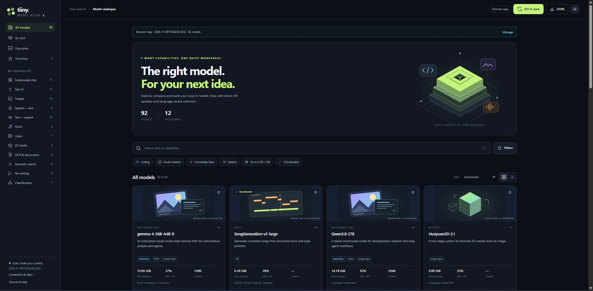

# 🗺️ Tiiny AI Model Store Atlas

**Explore, filter, and compare AI models available in the Tiiny AI Model Store — directly in your browser.**

Tiiny AI Model Store Atlas is a standalone, interactive HTML catalogue designed to help you choose the right model for your task. It includes detailed model profiles, technical specifications, practical use cases, and example prompts. The included snapshot covers **92 models**; you can refresh the catalogue with data from your Tiiny device.

## 🚀 Live Preview

👉 **[OPEN THE INTERACTIVE ATLAS](https://us4lkw.github.io/tiiny-ai-model-atlas/)**

## 📸 Interface Preview

## ✨ Key Features

- **🔎 Search and smart filters:** Browse by task, model category, capabilities, supported languages, input/output modalities, and more.
- **↕️ Flexible sorting:** Sort by Model Store order, name, model size, context window, NPU usage, and other available metrics.
- **📋 Detailed model profiles:** Explore descriptions, strengths, limitations, supported features, and practical example prompts.
- **⚖️ Model comparison:** Compare up to four models side by side.
- **⭐ Favorites:** Keep a shortlist of interesting models in your browser.
- **🌐 Language-aware discovery:** Filter by language and its intended use, with indications of how well the language information is documented.
- **🌓 Dark and light themes:** Dark mode by default, with a light-mode option.
- **🔄 Catalogue updates:** Import a JSON snapshot or request the latest catalogue directly from a Tiiny device through its local API.
- **📁 Optional local JSON snapshot:** In compatible browsers, grant access to a folder to read and update a `Tiiny_online_models.json` file.
- **💻 Standalone and offline-ready:** The catalogue and interface are embedded in a single HTML file; no installation or server is required for offline browsing.

## 📥 Download & Run Locally

1. **[DOWNLOAD `index.html`](https://github.com/US4LKW/tiiny-ai-model-atlas/releases/download/v2.1/index.html)**
2. Save the page as **`index.html`** on your computer. If your browser displays HTML source instead of downloading it, right-click the link and choose **Save link as…**
3. Open the saved file in a modern desktop browser (Chrome or Edge recommended for optional folder access).

No Python, dependencies, or web server are needed to browse the built-in catalogue.

## 🔄 Update the Model Catalogue

The atlas comes with a built-in snapshot, so it works without a Tiiny device. To update the data, open **API & Data** in the atlas and choose one of these methods:

**Option A — Connect to your Tiiny device**

1. Enter the device URL (default: `http://tiinyhost.local`) and your Tiiny API key.
2. Select **Update via API**.
3. The atlas refreshes its in-browser catalogue using the returned model metadata.

Direct browser access depends on your device being reachable and allowing the request via **CORS**. If your browser blocks it, use Option B.

**Option B — Import a JSON snapshot**

Import a compatible JSON file generated by `Tiiny_API_sync.py`, or drag the file onto the atlas. This also works when direct API access is unavailable.

**Optional: keep a JSON file in a selected folder**

In supported browsers, grant the atlas permission to access a folder (for example, the folder containing `index.html`). It can then read and, with your permission, update `Tiiny_online_models.json` there. A page opened from `file://` cannot silently read or write neighboring files without browser permission.

> **Privacy note:** The atlas can remember the device URL, preferences, and (if enabled) API key in browser storage. A saved API key is **not encrypted**. Only enable this on a trusted computer/browser profile. The key is not included in exported catalogue JSON files. Connecting directly to an HTTP device on your LAN does not encrypt the connection.

## 📊 Data & Accuracy

- **Included catalogue:** 92 models from a Tiiny Model Store snapshot dated **November 9, 2026**.
- **Technical fields:** Model Store/API metadata, including supported capabilities, sizes, context windows, and NPU usage when provided.
- **Descriptions and examples:** Explanatory content intended to assist model selection; examples are **illustrative prompts**, not verified outputs from running each model.
- **Language coverage:** Based on available model descriptions and published model-family information; not every model has a complete, verified language list.
- **Availability and licenses:** Models, versions, capabilities, usage conditions, and license terms can change. Confirm the current terms before commercial use.

## 🔗 Resources

- [Tiiny AI Help Center](https://help.tiiny.ai/)
- [Tiiny AI Developer Documentation](https://dev.tiiny.ai/)
- [Community API notes (unofficial)](https://github.com/thezolon/tiiny-api-notes)
- [📝 Post on Tiinyverse](https://www.tiinyverse.com/posts/a350cc15-438e-45bd-b4d4-da59b9208c81)

---

**Independent community project.** Not an official Tiiny AI product or endorsement.
